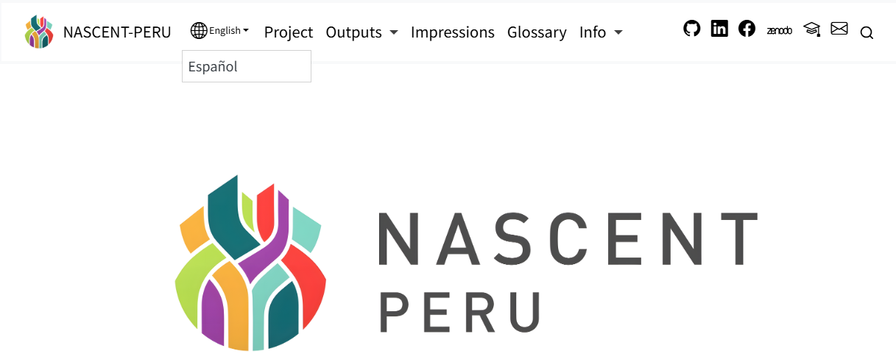

Thanks to the nifty R package [`babelquarto`](https://docs.ropensci.org/babelquarto/) you can also produce Quarto content in multiple languages with a link to switch between them. The package currently does this for project types with HTML output, such as books and websites, and one of the authors has recently contributed [some code](https://blenback.github.io/posts/2026-06-04-babelquarto-revealjs.html) to expand this to presentations (revealjs) as well.

The package's website has full vignettes on how to use it. In short, you enter the language options in your `_quarto.yml` file.

``` yaml
babelquarto:
  languagelinks: navbar
  languagecodes:
  - name: de
    text: "DE"
  - name: en
    text: "EN"
  mainlanguage: 'en'
  languages: ['de']
title-de: Arbeitsgruppe „Daten- und Modellierungsinfrastruktur für Living Labs“
description-de: „Dies ist die Website der Arbeitsgruppe „Daten- und Modellierungsinfrastruktur für Living Labs“ (SWG) des Innovationszentrums für Agrarsystemtransformation (IAT) als Teil des Leibniz-Zentrums für Agrarlandschaftsforschung (ZALF).“
author-de: author in de
lang: en
```

::: callout-tip
`babelquarto` has functions such as `quarto_multilingual_book()` that initialise a project and fill in the required YAML entries for you.
:::

Then you create a copy of each `.qmd` file that you would like to offer in another language, with the language code as a suffix in the file name: for example `index.qmd` (the English version) and `index.de.qmd` (the German version).

The project is then rendered with the appropriate babelquarto function (`render_website()` or `render_book()`) and the rendered files for the other languages are placed in a sub-directory of the project's output directory named after the language code.

You will see that pages then have a button in the navbar for changing languages:



::: callout-tip
The appearance of the language button can be changed with Sass or CSS. Here is an example from one of our own websites:

```{.scss code-fold="true" code-summary="Show the Sass"}
.navbar {
  /* The wrapping <li> is the flex item inside .navbar-nav. Push it to
     the right and give it nav-link horizontal padding so the gap to
     the next nav-item matches the rest of the navbar. */
  .navbar-nav > li:has(#languages-links-parent) {
    order: 999;
    margin-inline-start: auto;
    padding-inline: var(--bs-nav-link-padding-x, 1rem);
  }

  #languages-links-parent {
    display: inline-flex;
    align-items: baseline;
    gap: 0.25rem;

    /* Current-language toggle button — active style */
    .babelquarto-languages-button {
      background-color: transparent !important;
      border: none !important;
      box-shadow: none !important;
      border-radius: 0 !important;
      padding: var(--bs-nav-link-padding-y, 0.5rem) 0 !important;

      color: $brand-teal-dark !important;
      font-size: inherit;
      font-weight: 600;
      text-decoration: underline;
      text-underline-offset: 4px;
      text-decoration-thickness: 1.5px;

      /* Bootstrap's dropdown caret + the globe icon */
      &::after { display: none !important; }
      .bi-globe2,
      .bi-globe,
      i.bi { display: none !important; }

      &:hover,
      &:focus,
      &:active,
      &.show {
        background-color: transparent !important;
        color: $brand-teal-dark !important;
        box-shadow: none !important;
      }
    }

    /* Promote the dropdown menu to render inline (not as a floating popup) */
    > .dropdown-menu,
    #languages-links {
      display: inline-flex !important;
      position: static !important;
      float: none !important;
      inset: auto !important;
      transform: none !important;
      background: transparent !important;
      border: none !important;
      box-shadow: none !important;
      border-radius: 0 !important;
      padding: 0 !important;
      margin: 0 !important;
      list-style: none !important;
      min-width: 0 !important;
      align-items: baseline;
      gap: 0.4rem;

      /* Each <li> precedes its item with a slash separator */
      > li {
        display: inline-flex;
        align-items: baseline;
        gap: 0.4rem;

        &::before {
          content: "/";
          color: #9CA29F;
          font-weight: 500;
        }
      }

      .dropdown-item {
        display: inline;
        width: auto !important;
        padding: var(--bs-nav-link-padding-y, 0.5rem) 0 !important;
        background: transparent !important;
        color: #9CA29F !important;
        font-size: inherit;
        font-weight: 500;
        text-decoration: none !important;
        transition: color 0.15s ease;

        &:hover,
        &:focus {
          color: $brand-teal-dark !important;
          text-decoration: underline !important;
          text-underline-offset: 4px;
          background: transparent !important;
        }
      }
    }
  }
}

/* Force the language switcher into a consistent visual order regardless
   of which language page we're on. The real flex children of
   #languages-links-parent are the button (current lang) and the
   ul.dropdown-menu (other lang) — NOT the <li> inside the menu, which
   sits inside a separate inline-flex context.

   On EN pages the natural source order is "[button EN][ul / DE]" →
   "EN / DE", which is already correct, so no override needed.

   On DE pages the natural order would render "DE / EN" (and flip
   positions on each language click). We swap by pulling the menu to
   the left, suppressing the menu's leading slash, and adding a fresh
   leading slash to the button (now the rightmost item). */
html[lang="de"] #languages-links-parent {
  > .dropdown-menu,
  > #languages-links {
    order: -1;                                      /* EN other → left  */
    > li::before { content: none !important; }      /* drop leading "/" */
  }

  .babelquarto-languages-button {
    /* default order keeps button to the right of the menu (DE → right) */
    &::before {
      content: "/";
      /* inline-block + explicit text-decoration: none breaks the
         button's underline from extending across the slash */
      display: inline-block;
      text-decoration: none;
      color: #9CA29F;
      font-weight: 500;
      margin-inline-end: 0.4rem;
    }
  }
}

.navbar-logo {
  max-height: 44px;
}

/* On desktop, pin the language switcher to the far-right edge of the
   navbar by absolute-positioning its wrapping <li>. This leaves the
   regular nav links, the search button, and the theme toggle in their
   normal flex positions and only the switcher sits to their right.

   `.navbar.fixed-top` already has `position: fixed`, so it is the
   nearest positioned ancestor; `right: 1rem` anchors to its right edge.

   On mobile (< 992px) the wrapping <li> stays in-flow inside the
   collapsed nav menu — absolute positioning is scoped to lg+ only. */
@media (min-width: 992px) {
  .navbar .navbar-nav > li:has(#languages-links-parent) {
    position: absolute;
    right: 1rem;
    top: 50%;
    transform: translateY(-50%);

    /* Undo the in-flow nudges from the base rule above; absolute items
       don't participate in the flex layout and these would otherwise
       leave behind ghost spacing inside the nav-nav. */
    order: 0;
    margin-inline-start: 0;
    padding-inline: 0;
  }

  /* Reserve right-side padding on the navbar container so the absolutely-
     positioned switcher cannot overlap the search button at narrow lg. */
  .navbar > .container-fluid,
  .navbar > .container {
    padding-inline-end: 6rem;
  }
}
```
:::