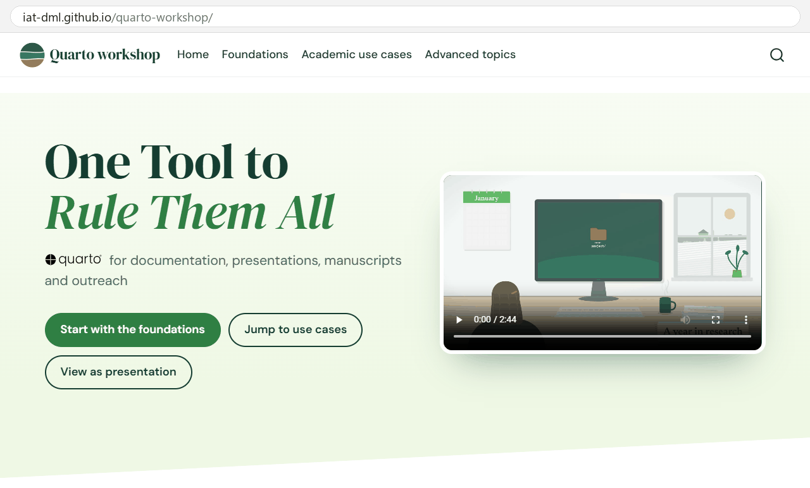
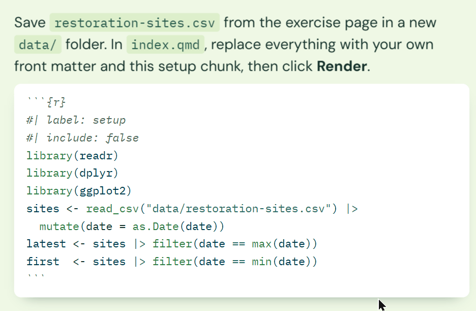
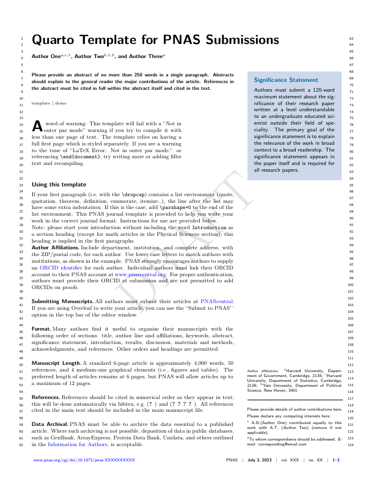

```{r}
#| label: setup
#| include: false
# Same code as Steps 4 and 5 of the manuscript exercise, so the numbers on the
# slides match what participants get.
library(readr)
library(dplyr)

sites <- read_csv("../data/restoration-sites.csv") |>
  mutate(date = as.Date(date))

latest <- sites |> filter(date == max(date))
first  <- sites |> filter(date == min(date))
by_date <- sites |> group_by(date) |> summarise(cover = mean(vegetation_cover_pct))

brand_colours <- yaml::read_yaml("../_brand.yml")$color$palette
```

## We build one manuscript together, then you pick your own use case {#plan}

<!-- --start and --len are minutes from 13:00; they place each bar on the 90-minute timeline. -->
::: {.agenda}
::: {.agenda-row style="--start: 0; --len: 15;"}
[13:00]{.agenda-time}
[The basics]{.agenda-title}
[Welcome, what Quarto is, Markdown and YAML]{.agenda-desc}
[15 min]{.agenda-len}
:::

::: {.agenda-row style="--start: 15; --len: 30;"}
[13:15]{.agenda-time}
[Demo: a manuscript, built together]{.agenda-title}
[You follow along on your laptop, one step at a time]{.agenda-desc}
[30 min]{.agenda-len}
:::

::: {.agenda-row style="--start: 45; --len: 40;"}
[13:45]{.agenda-time}
[Your turn]{.agenda-title}
[Pick a use case and work through its exercise on the website]{.agenda-desc}
[40 min]{.agenda-len}
:::

::: {.agenda-row style="--start: 85; --len: 5;"}
[14:25]{.agenda-time}
[Wrap-up and questions]{.agenda-title}
[Where to go next, and a follow-up talk on ]{.agenda-desc}
[5 min]{.agenda-len}
:::
:::

[If you already know Quarto, skip the demo and start on an exercise straight away.]{.catch-up}

::: {.notes}
Three parts, in the same order as the end of the pitch video. In the demo everyone builds the same manuscript on their own laptop while I do it on screen. The website stays online after today.
:::

## Open the workshop website on your laptop now {#website}

:::: {.columns}
::: {.column width="36%"}
[iat-dml.github.io/quarto-workshop](https://iat-dml.github.io/quarto-workshop/){.site-url}

{.qr-code fig-alt="QR code that opens the workshop website"}

Everything for today is on it: these slides, and a guide and an exercise for each use case. It stays online after today.
:::

::: {.column width="64%"}
{.screencast fig-alt="Screen recording: on the workshop home page, a click on View as presentation opens these slides in the browser"}

[**View as presentation** on the home page opens these slides, so you can follow them on your own screen.]{.screencast-caption}
:::
::::

::: {.notes}
Give everyone a minute to open the site; the QR code goes to the home page. The rest of the afternoon runs off this page, so it is worth getting it open now rather than during the demo.

On their own copy of the slides, the arrow keys move between slides; they can match the slide number at the top right to the one on the projector.
:::

## Copy any code block from the slides if you fall behind {#copy-code}

:::: {.columns}
::: {.column width="60%"}
{.screencast fig-alt="Screen recording: the mouse moves over a code block on a slide, a copy button appears in its corner, and a click copies the code"}
:::

::: {.column width="40%"}
- Move the mouse over a code block and a copy button appears in its top right corner.
- Click it, then paste the code into RStudio with Ctrl+V.
- Every code block in the exercises on the website has the same button.
:::
::::

::: {.notes}
This is the safety net for the demo. If someone misses a step while I am typing, they copy that step's code from their own copy of the slides and are back in step with everyone else. I'd still rather they type it where they can; more on that just before the demo starts.
:::

# The basics {#sec-basics .divider .divider-indigo background-color="#3D2F8C"}

Markdown for the text, YAML for the settings and, where you need it, code for the results.

## Quarto turns a plain-text file into documents, slides and websites {#what-is-quarto}

- Quarto is an open-source publishing system from Posit, the company behind RStudio.
- If you know R Markdown, most of it will look familiar: Quarto is its successor.
- It works with R, Python or Julia, or with no code at all.
- You keep your editor: RStudio, Positron and VS Code all support `.qmd` files.

::: {.notes}
Quarto is the publishing step: it takes a source file and turns it into a document, a slide deck or a website. It is not a new programming language, and you don't need a new editor.

If you've used R Markdown, Quarto is the newer and broader version of the same idea. If you haven't, you haven't missed a prerequisite. This deck is itself a Quarto file.
:::

## A .qmd file combines YAML settings, Markdown text and optional code {#qmd-anatomy}

:::: {.columns}
::: {.column width="52%"}
[report.qmd]{.file-label}

```` markdown
---
title: "Restoration monitoring"
format: html
---

## Results

The boxplot shows vegetation cover at **each** site.

```{{r}}
sites <- read.csv("restoration-sites.csv")
boxplot(vegetation_cover_pct ~ site, data = sites)
```
````
:::

::: {.column width="48%"}
- The YAML header between the `---` lines holds the settings, such as the title and the output format.
- Markdown marks up the text: `##` starts a heading and `**` makes text bold.
- A code chunk runs when you render, and its output, here a boxplot, appears in the document.
:::
::::

::: {.notes}
This is the one model to keep in mind for the whole afternoon: YAML for the settings, Markdown for the text, and code where you want computed results. Quarto renders the three into the output you ask for. The demo and every exercise apply this same model.

Because the file is plain text, version control can show every change line by line.
:::

## You have probably written Markdown already, even without programming {#markdown-everywhere}

::: {.compact}
John Gruber designed Markdown in 2004 so that formatted text still reads naturally as plain text. Many tools researchers use every day now format text with it.

| Where you have seen it | What Markdown does there |
|---|---|
| AI assistants such as ChatGPT and Copilot | The headings, bold text and lists in each answer are Markdown |
| Chat in Teams and Slack | Asterisks around a word make it bold |
| README files on GitHub and GitLab | The start page of a repository is a `README.md` file |
| Jupyter notebooks | The text cells between the code cells are Markdown |
| Note apps such as Obsidian and Joplin | Every note is written in Markdown |
:::

::: {.notes}
Ask for a show of hands: who has bolded a word in Teams by typing asterisks around it? That was Markdown. Who has used ChatGPT or Copilot? The answers arrive as Markdown, and the chat window renders it; copy an answer as plain text and the hashes and asterisks show.

Gruber's aim was text that reads well as it is, like an email, and that a program can turn into a web page. That is why it spread: the source is readable without the program that made it, so it suits version control and outlives any one editor.

Quarto uses Pandoc's version of Markdown, which adds what academic writing needs on top: citations, footnotes, cross-references and figure captions.
:::

## Markdown marks what the text is, and Quarto decides how it looks {#markdown .source-result}

:::: {.columns}
::: {.column width="50%"}
[methods.qmd]{.file-label}

```` markdown
### Field methods

We surveyed **every plot** twice a year
and recorded *all* vascular plants.

- Spring survey in May
- Autumn survey in September

The full protocol is on the
[website](https://iat-dml.github.io/quarto-workshop/).
````
:::

::: {.column width="50%"}
[methods.html]{.file-label}

<!-- A Markdown heading here would split the slide into a vertical stack, so the rendered side uses an HTML heading. -->
::: {.rendered}
<h3>Field methods</h3>

We surveyed **every plot** twice a year and recorded *all* vascular plants.

- Spring survey in May
- Autumn survey in September

The full protocol is on the [website](https://iat-dml.github.io/quarto-workshop/).
:::
:::
::::

::: {.notes}
Markdown describes what something is, not how it looks. Hashes mean "this is a heading"; the output format decides the font and size, so the same source works as a web page, a PDF or a slide.

Walk through it line by line: one hash per heading level, two asterisks for bold, one for italic, a hyphen for each bullet, and square brackets then round brackets for a link.
:::

## Numbered lists, tables and images are plain text too {#markdown-more .source-result}

:::: {.columns}
::: {.column width="50%"}
[methods.qmd]{.file-label}

```` markdown
1. Clip the vegetation in each plot.
2. Dry the samples at 60 °C for 48 hours.

| Site   | Cover (%) | Species |
|--------|----------:|--------:|
| Site A |        62 |      17 |
| Site B |        50 |      15 |
| Site C |        44 |      14 |
| Site D |        70 |      21 |


````

[Quotes, footnotes and equations are just as short: see Markdown for beginners on the website.]{.catch-up}
:::

::: {.column width="50%"}
[methods.html]{.file-label}

::: {.rendered}
1. Clip the vegetation in each plot.
2. Dry the samples at 60 °C for 48 hours.

| Site   | Cover (%) | Species |
|--------|----------:|--------:|
| Site A |        62 |      17 |
| Site B |        50 |      15 |
| Site C |        44 |      14 |
| Site D |        70 |      21 |

```{r}
#| label: cover-by-site
#| fig-width: 7
#| fig-height: 1.7
#| fig-cap: "Vegetation cover in January 2025"
#| fig-alt: "Horizontal bar chart of vegetation cover at the four sites in January 2025"
par(family = "sans", mar = c(2.2, 4.5, 0.3, 0.5), bg = NA,
    col.axis = brand_colours$muted, fg = brand_colours$muted)
barplot(rev(latest$vegetation_cover_pct), names.arg = rev(latest$site),
        horiz = TRUE, las = 1, border = NA, col = brand_colours$green,
        xlim = c(0, 80))
```
:::
:::
::::

::: {.notes}
A number and a full stop start a numbered list; Quarto numbers the items for you, so you can insert a step without renumbering. The table is drawn with pipes and hyphens, and the colons in the line under the header right-align the numbers. An image is a link with an exclamation mark in front, and the text in the square brackets becomes the caption.

The numbers are the latest survey in the workshop data, the same data we use in the demo.
:::

## One line in the YAML header decides the output format {#yaml}

:::: {.columns}
::: {.column width="45%"}
[report.qmd]{.file-label}

```` yaml
---
title: "Restoration monitoring"
author: "Ben Black"
format: html
---
````
:::

::: {.column width="55%"}
| `format:` | What you get |
|---|---|
| `html` | A web page |
| `docx` | A Word document |
| `typst` | A PDF, with no LaTeX install needed |
| `revealjs` | Slides like these |
:::
::::

::: {.notes}
YAML is a settings panel written as text, between the two `---` lines at the top. Each line is a `key: value` pair. Change `html` to `docx`, render again, and the same text comes out as a Word file. A paper and a talk still need different editing, but the switch itself is this small.

Typst is a typesetting system that ships with Quarto. `format: pdf` goes through LaTeX instead.

Indentation matters in YAML. If a render fails before it reaches your text, check the header first for a stray space or a missing colon.
:::

# Demo: writing a manuscript together {#sec-demo .divider .divider-moss background-color="#2F7D6A"}

We build one short article step by step, you on your laptop and I on screen, from the data to a PDF, a web page and a Word file.

## How do you prepare a manuscript today, and what goes wrong? {#ask-manuscripts .question}

Think about the software rather than the science:

- Where do you analyse the data and make the figures?
- Where do you and your co-authors write the text?
- How does it end up in the format the journal asks for?

::: {.notes}
Ask for two or three answers from the room before moving on.

Answers I expect: R, Python, SPSS or Excel for the analysis; Word with track changes, passed round by email or shared on OneDrive; Zotero, EndNote or Citavi for the references; the journal's template applied at the very end. Problems I expect: pasting in updated figures, numbers in the text that no longer match the analysis, merging co-authors' versions, reference fields breaking, reformatting for the journal.

Pick up the two that come up most and lead into the next two slides: analysis and writing happen in different programs, and every journal wants a different file.
:::

## Analysis and text in separate programs drift apart {#problem-two-programs .problem}

:::: {.columns}
::: {.column width="56%"}
{fig-alt="Stand-in image until the pitch-video still is exported: a lab notebook with figures"}
:::

::: {.column width="44%"}
The data are analysed in R, Python or Excel, and the text is written in Word. Every figure, table and number is copied across by hand, and every new analysis means copying them again. Sooner or later one is missed.

[In Quarto the analysis and the text share one file, so one render updates both.]{.answer}
:::
::::

::: {.notes}
This is the problem most people name. A changed filter, a corrected data point or a reviewer's request for a different model, and every figure, table and number that depends on it has to be found in the Word file and replaced. The risk is not the work but the one value nobody remembers to update.
:::

## Numbers in the text come from the same code as the figures {#source-result .source-result}

:::: {.columns}
::: {.column width="48%"}
[index.qmd]{.file-label}

```` markdown
```{{r}}
sites <- read_csv("data/restoration-sites.csv")
```

We monitored `r knitr::inline_expr("n_distinct(sites$site)")`
restoration sites. Mean vegetation cover
rose from `r knitr::inline_expr("round(mean(first$vegetation_cover_pct))")`%
to `r knitr::inline_expr("round(mean(latest$vegetation_cover_pct))")`%.
````
:::

::: {.column width="52%"}
[index.html]{.file-label}

::: {.rendered}
We monitored `r n_distinct(sites$site)` restoration sites. Mean vegetation cover rose from `r round(mean(first$vegetation_cover_pct))`% to `r round(mean(latest$vegetation_cover_pct))`%.

```{r}
#| label: cover-plot
#| fig-width: 7
#| fig-height: 3.2
#| fig-alt: "Line chart of mean vegetation cover across monitoring dates"
par(family = "sans", mar = c(4, 4, 0.5, 0.5), bg = NA,
    col.axis = brand_colours$muted, fg = brand_colours$muted)
plot(by_date$date, by_date$cover, type = "b", pch = 19, lwd = 2,
     col = brand_colours$green, xlab = "Monitoring date", ylab = "Mean vegetation cover (%)",
     bty = "n")
```
:::
:::
::::

::: {.notes}
This slide is itself rendered by Quarto: the numbers on the right were computed from the workshop data when the deck was built. Change the data, render again, and the sentence and the figure change together.
:::

## Journals ask for different files: Word, PDF or LaTeX {#problem-formats .problem}

:::: {.columns}
::: {.column width="56%"}
{.page-top fig-alt="A manuscript rendered by Quarto in the PNAS journal template, set in LaTeX"}
:::

::: {.column width="44%"}
Some journals accept Word, some a PDF and some LaTeX, which gives precise control over equations, tables and layout. Moving a Word draft into LaTeX means redoing the formatting and references by hand.

[Quarto renders one source to Word, PDF and LaTeX, and journal templates apply each publisher's style.]{.answer}
:::
::::

::: {.notes}
The image is a Quarto manuscript in the PNAS template. There are templates for Elsevier, PLOS, ACS and other publishers in the quarto-journals collection on GitHub, and the optional last step of the manuscript exercise uses the Elsevier one. With `keep-tex: true` the LaTeX source is kept next to the PDF, ready to upload.

Co-authors who only use Word still get a Word file from the same source, which is Step 6 of the demo.
:::

## Build the manuscript on your laptop as I build it on screen {#follow-along}

:::: {.columns}
::: {.column width="58%"}
- I go through six steps on screen, and you do each one on your own laptop.
- Type the code yourself where you can. You will remember it better than code you pasted.
- If you fall behind, copy the code from the slide on your own screen and carry on with the next step.
- Each step slide also names the matching step of the manuscript exercise on the website.
:::

::: {.column width="42%"}
::: {.steps}
1. Create a manuscript project
2. Add authors and a setup chunk
3. Put numbers from the data into the text
4. Add a figure and cross-reference it
5. Cite a paper by its DOI
6. Render to PDF, HTML and Word
:::
:::
::::

::: {.notes}
Say it plainly: I want everyone typing, not watching. Copying is there so nobody gets stuck for long, not as the default. Before Step 1 we check two things on every laptop: that Quarto runs and that R is set up.
:::

## Check that your editor can find Quarto before we start {#check-quarto}

::: {.panel-tabset}
### RStudio

RStudio 2022.07 and later include Quarto. In the **Terminal** tab, run:

```` bash
quarto --version
````

### Positron

Positron includes Quarto. Press <kbd>Ctrl</kbd>+<kbd>Shift</kbd>+<kbd>P</kbd> and run **Quarto: Verify Installation**. A dialog shows the version and where Quarto is installed.

### VS Code

Install the **Quarto** extension, then press <kbd>Ctrl</kbd>+<kbd>Shift</kbd>+<kbd>P</kbd> and run **Quarto: Verify Installation**. On a ZALF laptop, VS Code finds RStudio's copy of Quarto only once you set `quarto.path`, as described on the website.

### Terminal

In any terminal, run:

```` bash
quarto check
````

It lists the versions of Quarto and its tools, then checks R and Python.
:::

[You need Quarto 1.8 or newer. Not found, or too old? Installing Quarto on the website covers each editor.]{.catch-up}

::: {.notes}
On ZALF laptops RStudio 2026.01 from the Baramundi Kiosk comes with Quarto 1.8.25, which is enough for everything today. Positron brings its own, newer copy.

VS Code users on a ZALF laptop need the `quarto.path` setting from "Setting up on a ZALF laptop" on the Installing Quarto page, or the per-user Quarto installer, which needs no admin rights.
:::

## Set up R: one setting on ZALF laptops, then three packages {#setup-r}

1. On a ZALF laptop, run this once in PowerShell, then restart RStudio. Without it, documents with R code fail to render.

    ```` powershell
    [Environment]::SetEnvironmentVariable('R_USER', $env:USERPROFILE, 'User')
    ````

2. Install the packages the demo uses, in the RStudio console:

    ```` r
    install.packages(c("readr", "dplyr", "ggplot2"))
    ````

[Both steps are under "Setting up on a ZALF laptop" on the website.]{.catch-up}

::: {.notes}
The ZALF Documents folder lives in OneDrive under a path with "für" in it, and R cannot read that path. Setting `R_USER` points R at the plain user folder instead.

The package install takes a few minutes. Start it now and let it run while we create the project in Step 1; the packages are first needed in Step 2.
:::

## Step 1 of 6: create a manuscript project and choose its formats {#checkpoint-1 .checkpoint}

:::: {.columns}
::: {.column width="60%"}
Open the manuscript exercise on the website. In RStudio choose **File → New Project → New Directory → Quarto Manuscript**, in a folder outside OneDrive. Then replace `_quarto.yml` with:

```` yaml
project:
  type: manuscript

format:
  typst: default
  html: default
````

[Behind? These are Steps 1 and 3 of the exercise.]{.catch-up}
:::

::: {.column width="40%"}
::: {.steps}
1. **Create a manuscript project**
2. Add authors and a setup chunk
3. Put numbers from the data into the text
4. Add a figure and cross-reference it
5. Cite a paper by its DOI
6. Render to PDF, HTML and Word
:::
:::
::::

::: {.notes}
Every code block on the exercise page has a copy button, so nobody has to type from the screen.

Two reasons to replace `_quarto.yml` straight away. The starter file has `freeze: true`, which reuses old results, so the numbers in Step 3 would not update when the data changes. And on Quarto 1.8, the version in RStudio, the PDF fails if `html` comes before it in the list. Typst is built into Quarto, so the PDF needs no LaTeX install.
:::

## Step 2 of 6: add authors and a setup chunk that loads the data {#checkpoint-2 .checkpoint}

:::: {.columns}
::: {.column width="60%"}
Save `restoration-sites.csv` from the exercise page in a new `data/` folder. In `index.qmd`, replace everything with your own front matter and this setup chunk, then click **Render**.

```` markdown
```{{r}}
#| label: setup
#| include: false
library(readr)
library(dplyr)
library(ggplot2)
sites <- read_csv("data/restoration-sites.csv") |>
  mutate(date = as.Date(date))
latest <- sites |> filter(date == max(date))
first  <- sites |> filter(date == min(date))
```
````

[Behind? The front matter is in Step 2 of the exercise and the setup chunk in Step 4.]{.catch-up}
:::

::: {.column width="40%"}
::: {.steps}
1. Create a manuscript project
2. **Add authors and a setup chunk**
3. Put numbers from the data into the text
4. Add a figure and cross-reference it
5. Cite a paper by its DOI
6. Render to PDF, HTML and Word
:::
:::
::::

::: {.notes}
The front matter holds the title, the authors with ORCID and affiliation, and the bibliography file. Quarto builds the byline from it in every format. `include: false` runs the setup chunk but keeps the code and its output out of the article.

The Render button shows the first format in the list, so the Viewer shows the PDF. If a render fails with "file name conversion problem", `R_USER` is not set yet.
:::

## Step 3 of 6: put numbers from the data into the text {#checkpoint-3 .checkpoint}

:::: {.columns}
::: {.column width="60%"}
Below the setup chunk, add the paragraph from the exercise, then render. It starts like this:

```` markdown
We monitored vegetation recovery at
`r knitr::inline_expr("n_distinct(sites$site)")` restoration sites
across `r knitr::inline_expr("n_distinct(sites$date)")` quarterly surveys.
````

[Behind? The full paragraph is in Step 5 of the exercise.]{.catch-up}
:::

::: {.column width="40%"}
::: {.steps}
1. Create a manuscript project
2. Add authors and a setup chunk
3. **Put numbers from the data into the text**
4. Add a figure and cross-reference it
5. Cite a paper by its DOI
6. Render to PDF, HTML and Word
:::
:::
::::

::: {.notes}
The rendered text should read: `r n_distinct(sites$site)` sites, `r n_distinct(sites$date)` surveys, cover from `r round(mean(first$vegetation_cover_pct))`% to `r round(mean(latest$vegetation_cover_pct))`%, an increase of `r round(mean(latest$vegetation_cover_pct) - mean(first$vegetation_cover_pct))` percentage points.

If there is time: change one cover value in the CSV, render again and show that the sentence changes. Then change it back.
:::

## Step 4 of 6: a labelled figure gets a number and a link {#checkpoint-4 .checkpoint}

:::: {.columns}
::: {.column width="60%"}
Below the paragraph, add the figure chunk from the exercise. Its label is `fig-cover`, so the text can refer to it:

```` markdown
Cover increased at every site over the
monitoring period (@fig-cover).
````

[Behind? The chunk and this sentence are in Step 6 of the exercise.]{.catch-up}
:::

::: {.column width="40%"}
::: {.steps}
1. Create a manuscript project
2. Add authors and a setup chunk
3. Put numbers from the data into the text
4. **Add a figure and cross-reference it**
5. Cite a paper by its DOI
6. Render to PDF, HTML and Word
:::
:::
::::

::: {.notes}
After rendering, `@fig-cover` reads "Figure 1" and links to the figure, and the caption is numbered. Add a second figure above it and both numbers update.
:::

## Step 5 of 6: a DOI is all you need to add a citation {#checkpoint-5 .checkpoint}

:::: {.columns}
::: {.column width="60%"}
Switch to the **Visual** editor, put the cursor at the end of the text and choose **Insert → Citation**. Pick **From DOI** and paste:

```` default
10.1111/rec.13035
````

Quarto adds the entry to `references.bib` and a reference list to the end of the article.

[No internet, or no dialog? Paste the reference from the tip in Step 7 of the exercise into `references.bib` and cite it as `[@gann2019]`.]{.catch-up}
:::

::: {.column width="40%"}
::: {.steps}
1. Create a manuscript project
2. Add authors and a setup chunk
3. Put numbers from the data into the text
4. Add a figure and cross-reference it
5. **Cite a paper by its DOI**
6. Render to PDF, HTML and Word
:::
:::
::::

::: {.notes}
The DOI belongs to the SER international standards for ecological restoration (Gann et al. 2019). The same dialog can search Zotero, Crossref, PubMed and DataCite. The visual editor may rewrap the paragraph when you switch back to Source; the text itself does not change.
:::

## Step 6 of 6: one render gives PDF, web page and Word {#checkpoint-6 .checkpoint}

:::: {.columns}
::: {.column width="60%"}
Add `docx: default` to the formats in `_quarto.yml`. Then click **Render Project** in the Build tab, or run `quarto render` in the Terminal tab.

```` yaml
project:
  type: manuscript

format:
  typst: default
  html: default
  docx: default
````

[Behind? Rendering is Step 8 of the exercise.]{.catch-up}
:::

::: {.column width="40%"}
::: {.steps}
1. Create a manuscript project
2. Add authors and a setup chunk
3. Put numbers from the data into the text
4. Add a figure and cross-reference it
5. Cite a paper by its DOI
6. **Render to PDF, HTML and Word**
:::
:::
::::

::: {.notes}
The results land in `_manuscript/`. Open `index.html` in the browser: the margin links to the PDF and the Word file under Other Formats. The Render button only shows the first format, which is why this step renders the whole project.
:::

# Your turn: pick another use case and work through it {#sec-your-turn .divider .divider-indigo background-color="#3D2F8C"}

Each use case on the website has a guide with tips and an exercise. Work on one until 14:25, on either of two paths:

- Path A: bring your own content, such as a draft paper, a talk you need to give or your own data.
- Path B: use the sample data and text we provide.

I'll come round the room to answer questions and help when something does not render.

::: {.notes}
Leave this slide up for the whole 40 minutes. Path A pays off more, because people leave with something they keep working on; Path B is better for anyone who would rather not wrangle their own files today. People who skipped the demo can do the manuscript exercise now.

Walk the room. The problems we found when testing on ZALF laptops: `R_USER` not set, projects inside OneDrive, and VS Code not finding Quarto.
:::

# Wrap-up and questions {#sec-wrap-up .divider .divider-indigo background-color="#3D2F8C"}

All the material stays online after today, and the exercises work on your own laptop too.

## On 10 December I'll show how my CV and website stay current {#profile-talk}

:::: {.columns}
::: {.column width="55%"}
****\
, 

- I log each paper, talk and project once, as an entry in a YAML file.
- My CV and my website are both Quarto projects that read those files.
- GitHub Actions rebuild both whenever I add an entry.

Camille Imbert and Marlene Palka will send round the details.
:::

::: {.column width="45%"}
{fig-alt="Screenshot of Ben Black's personal website, built with Quarto"}
:::
::::

::: {.notes}
This is the "Your site and CV, always current" scene from the pitch video. In the talk I go through the whole setup: the YAML files, the check that stops a typo from breaking the CV, and how a new entry triggers both rebuilds. Camille and Marlene are sending out the invitation.
:::
