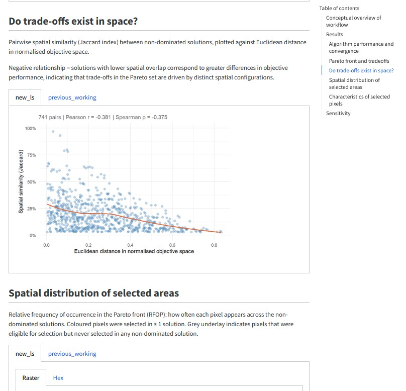
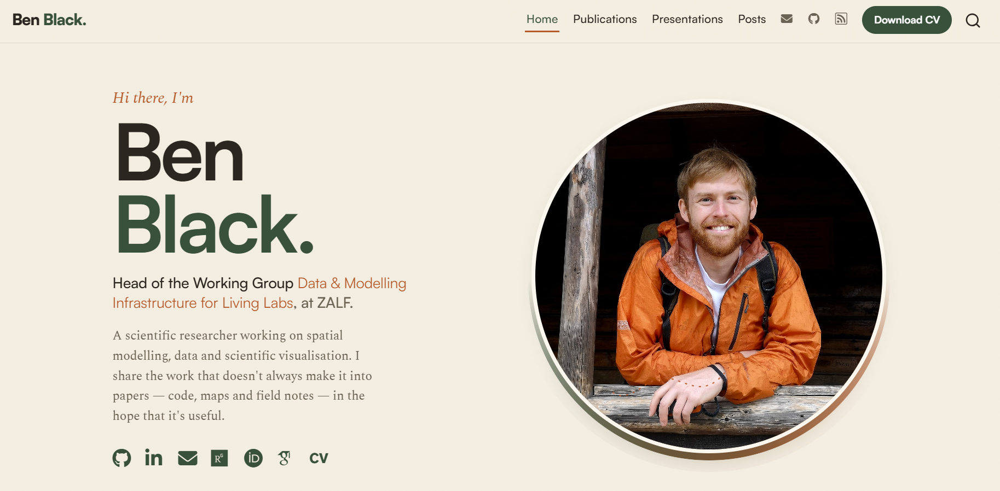

```{r}
#| label: setup
#| include: false
# Same code as Steps 4 and 5 of the manuscript exercise, so the numbers on the
# slides match what participants get.
library(readr)
library(dplyr)

sites <- read_csv("../data/restoration-sites.csv") |>
  mutate(date = as.Date(date))

latest <- sites |> filter(date == max(date))
first  <- sites |> filter(date == min(date))
by_date <- sites |> group_by(date) |> summarise(cover = mean(vegetation_cover_pct))
```

## We build one manuscript together, then you pick your own use case {#plan}

| Time | Part | Length |
|------|----------------------------------------|-------|
| 13:00 | Welcome and the basics: what Quarto is, Markdown and YAML | 15 min |
| 13:15 | Demo: we build a manuscript together, step by step | 30 min |
| 13:45 | Your turn: pick a use case and work through its exercise on the website | 40 min |
| 14:25 | Wrap-up and questions | 5 min |

If you already know Quarto, skip the demo and start on an exercise straight away.

::: {.notes}
Three parts, in the same order as the end of the pitch video. In the demo everyone builds the same manuscript on their own laptop while I do it on screen. Every step is also written out in the manuscript exercise on the website, with a copy button on each code block, so nobody needs to keep up with my typing. The website stays online after today.
:::

## Set up R on your laptop now, while I go through the basics {#setup-now}

1. On a ZALF laptop, run this once in PowerShell, then restart RStudio. Without it, documents with R code fail to render.

    ```` powershell
    [Environment]::SetEnvironmentVariable('R_USER', $env:USERPROFILE, 'User')
    ````

2. Install the packages the demo uses, in the RStudio console:

    ```` r
    install.packages(c("readr", "dplyr", "ggplot2"))
    ````

[Both steps are under "Setting up on a ZALF laptop" on the website.]{.catch-up}

::: {.notes}
The ZALF Documents folder lives in OneDrive under a path with "für" in it, and R cannot read that path. Setting `R_USER` points R at the plain user folder instead. The package install takes a few minutes, which is why I ask for it now rather than at Step 2.
:::

# The basics {#sec-basics .divider .divider-indigo background-color="#3D2F8C"}

Markdown for the text, YAML for the settings and, where you need it, code for the results.

## Quarto turns a plain-text file into documents, slides and websites {#what-is-quarto}

- Quarto is an open-source publishing system from Posit, the company behind RStudio.
- If you know R Markdown, most of it will look familiar: Quarto is its successor.
- It works with R, Python or Julia, or with no code at all.
- You keep your editor: RStudio, Positron and VS Code all support `.qmd` files.

::: {.notes}
Quarto is the publishing step: it takes a source file and turns it into a document, a slide deck or a website. It is not a new programming language, and you don't need a new editor.

If you've used R Markdown, Quarto is the newer and broader version of the same idea. If you haven't, you haven't missed a prerequisite. This deck is itself a Quarto file.
:::

## A .qmd file combines YAML settings, Markdown text and optional code {#qmd-anatomy}

:::: {.columns}
::: {.column width="52%"}
[report.qmd]{.file-label}

```` markdown
---
title: "Restoration monitoring"
format: html
---

## Results

The boxplot shows vegetation cover at **each** site.

```{{r}}
sites <- read.csv("restoration-sites.csv")
boxplot(vegetation_cover_pct ~ site, data = sites)
```
````
:::

::: {.column width="48%"}
- The YAML header between the `---` lines holds the settings, such as the title and the output format.
- Markdown marks up the text: `##` starts a heading and `**` makes text bold.
- A code chunk runs when you render, and its output, here a boxplot, appears in the document.
:::
::::

::: {.notes}
This is the one model to keep in mind for the whole afternoon: YAML for the settings, Markdown for the text, and code where you want computed results. Quarto renders the three into the output you ask for. The demo and every exercise apply this same model.

Because the file is plain text, version control can show every change line by line.
:::

## Markdown marks what the text is, and Quarto decides how it looks {#markdown .source-result}

:::: {.columns}
::: {.column width="50%"}
[methods.qmd]{.file-label}

```` markdown
### Field methods

We surveyed **every plot** twice a year
and recorded *all* vascular plants.

- Spring survey in May
- Autumn survey in September

The full protocol is on the
[website](https://iat-dml.github.io/quarto-workshop/).
````
:::

::: {.column width="50%"}
[methods.html]{.file-label}

<!-- A Markdown heading here would split the slide into a vertical stack, so the rendered side uses an HTML heading. -->
::: {.rendered}
<h3>Field methods</h3>

We surveyed **every plot** twice a year and recorded *all* vascular plants.

- Spring survey in May
- Autumn survey in September

The full protocol is on the [website](https://iat-dml.github.io/quarto-workshop/).
:::
:::
::::

::: {.notes}
Markdown describes what something is, not how it looks. Hashes mean "this is a heading"; the output format decides the font and size, so the same source works as a web page, a PDF or a slide.

This slide is most of what you need to start. Quarto adds the academic extras on top: citations, cross-references, figure captions and callouts. We'll see some of them in the demo, and the website has the full reference.
:::

## One line in the YAML header decides the output format {#yaml}

:::: {.columns}
::: {.column width="45%"}
[report.qmd]{.file-label}

```` yaml
---
title: "Restoration monitoring"
author: "Ben Black"
format: html
---
````
:::

::: {.column width="55%"}
| `format:` | What you get |
|---|---|
| `html` | A web page |
| `docx` | A Word document |
| `typst` | A PDF, with no LaTeX install needed |
| `revealjs` | Slides like these |
:::
::::

::: {.notes}
YAML is a settings panel written as text, between the two `---` lines at the top. Each line is a `key: value` pair. Change `html` to `docx`, render again, and the same text comes out as a Word file. A paper and a talk still need different editing, but the switch itself is this small.

Typst is a typesetting system that ships with Quarto. `format: pdf` goes through LaTeX instead.

Indentation matters in YAML. If a render fails before it reaches your text, check the header first for a stray space or a missing colon.
:::

# Manuscripts {#sec-manuscripts .divider .divider-moss background-color="#2F7D6A"}

From analysis to submission without copying a single number by hand.

## A reviewer's correction should be fixed in one place, not three {#problem-final .problem}

:::: {.columns}
::: {.column width="56%"}
{fig-alt="Stand-in image until the pitch-video still is exported: a lab notebook with figures"}
:::

::: {.column width="44%"}
Co-authors want Word, the journal wants LaTeX, and every revision changes a figure. Values in the text quietly fall out of date.

[With Quarto, the text, the numbers and the figures come from one source file.]{.answer}
:::
::::

## Numbers in the text come from the same code as the figures {#source-result .source-result}

:::: {.columns}
::: {.column width="48%"}
[index.qmd]{.file-label}

```` markdown
```{{r}}
sites <- read_csv("data/restoration-sites.csv")
```

We monitored `r knitr::inline_expr("n_distinct(sites$site)")`
restoration sites. Mean vegetation cover
rose from `r knitr::inline_expr("round(mean(first$vegetation_cover_pct))")`%
to `r knitr::inline_expr("round(mean(latest$vegetation_cover_pct))")`%.
````
:::

::: {.column width="52%"}
[index.html]{.file-label}

::: {.rendered}
We monitored `r n_distinct(sites$site)` restoration sites. Mean vegetation cover rose from `r round(mean(first$vegetation_cover_pct))`% to `r round(mean(latest$vegetation_cover_pct))`%.

```{r}
#| label: cover-plot
#| fig-width: 7
#| fig-height: 3.2
#| fig-alt: "Line chart of mean vegetation cover across monitoring dates"
brand_colours <- yaml::read_yaml("../_brand.yml")$color$palette
par(family = "sans", mar = c(4, 4, 0.5, 0.5), bg = NA,
    col.axis = brand_colours$muted, fg = brand_colours$muted)
plot(by_date$date, by_date$cover, type = "b", pch = 19, lwd = 2,
     col = brand_colours$green, xlab = "Monitoring date", ylab = "Mean vegetation cover (%)",
     bty = "n")
```
:::
:::
::::

::: {.notes}
This slide is itself rendered by Quarto: the numbers on the right were computed from the workshop data when the deck was built.
:::

## Step 1 of 6: create a manuscript project and choose its formats {#checkpoint-1 .checkpoint}

:::: {.columns}
::: {.column width="60%"}
Open the manuscript exercise on the website. In RStudio choose **File → New Project → New Directory → Quarto Manuscript**, in a folder outside OneDrive. Then replace `_quarto.yml` with:

```` yaml
project:
  type: manuscript

format:
  typst: default
  html: default
````

[Behind? These are Steps 1 and 3 of the exercise.]{.catch-up}
:::

::: {.column width="40%"}
::: {.steps}
1. **Create a manuscript project**
2. Add authors and a setup chunk
3. Put numbers from the data into the text
4. Add a figure and cross-reference it
5. Cite a paper by its DOI
6. Render to PDF, HTML and Word
:::
:::
::::

::: {.notes}
Every code block on the exercise page has a copy button, so nobody has to type from the screen.

Two reasons to replace `_quarto.yml` straight away. The starter file has `freeze: true`, which reuses old results, so the numbers in Step 3 would not update when the data changes. And on Quarto 1.8, the version in RStudio, the PDF fails if `html` comes before it in the list. Typst is built into Quarto, so the PDF needs no LaTeX install.
:::

## Step 2 of 6: add authors and a setup chunk that loads the data {#checkpoint-2 .checkpoint}

:::: {.columns}
::: {.column width="60%"}
Save `restoration-sites.csv` from the exercise page in a new `data/` folder. In `index.qmd`, replace everything with your own front matter and this setup chunk, then click **Render**.

```` markdown
```{{r}}
#| label: setup
#| include: false
library(readr)
library(dplyr)
library(ggplot2)
sites <- read_csv("data/restoration-sites.csv") |>
  mutate(date = as.Date(date))
latest <- sites |> filter(date == max(date))
first  <- sites |> filter(date == min(date))
```
````

[Behind? The front matter is in Step 2 of the exercise and the setup chunk in Step 4.]{.catch-up}
:::

::: {.column width="40%"}
::: {.steps}
1. Create a manuscript project
2. **Add authors and a setup chunk**
3. Put numbers from the data into the text
4. Add a figure and cross-reference it
5. Cite a paper by its DOI
6. Render to PDF, HTML and Word
:::
:::
::::

::: {.notes}
The front matter holds the title, the authors with ORCID and affiliation, and the bibliography file. Quarto builds the byline from it in every format. `include: false` runs the setup chunk but keeps the code and its output out of the article.

The Render button shows the first format in the list, so the Viewer shows the PDF. If a render fails with "file name conversion problem", `R_USER` is not set yet.
:::

## Step 3 of 6: put numbers from the data into the text {#checkpoint-3 .checkpoint}

:::: {.columns}
::: {.column width="60%"}
Below the setup chunk, add the paragraph from the exercise, then render. It starts like this:

```` markdown
We monitored vegetation recovery at
`r knitr::inline_expr("n_distinct(sites$site)")` restoration sites
across `r knitr::inline_expr("n_distinct(sites$date)")` quarterly surveys.
````

[Behind? The full paragraph is in Step 5 of the exercise.]{.catch-up}
:::

::: {.column width="40%"}
::: {.steps}
1. Create a manuscript project
2. Add authors and a setup chunk
3. **Put numbers from the data into the text**
4. Add a figure and cross-reference it
5. Cite a paper by its DOI
6. Render to PDF, HTML and Word
:::
:::
::::

::: {.notes}
The rendered text should read: `r n_distinct(sites$site)` sites, `r n_distinct(sites$date)` surveys, cover from `r round(mean(first$vegetation_cover_pct))`% to `r round(mean(latest$vegetation_cover_pct))`%, an increase of `r round(mean(latest$vegetation_cover_pct) - mean(first$vegetation_cover_pct))` percentage points.

If there is time: change one cover value in the CSV, render again and show that the sentence changes. Then change it back.
:::

## Step 4 of 6: a labelled figure gets a number and a link {#checkpoint-4 .checkpoint}

:::: {.columns}
::: {.column width="60%"}
Below the paragraph, add the figure chunk from the exercise. Its label is `fig-cover`, so the text can refer to it:

```` markdown
Cover increased at every site over the
monitoring period (@fig-cover).
````

[Behind? The chunk and this sentence are in Step 6 of the exercise.]{.catch-up}
:::

::: {.column width="40%"}
::: {.steps}
1. Create a manuscript project
2. Add authors and a setup chunk
3. Put numbers from the data into the text
4. **Add a figure and cross-reference it**
5. Cite a paper by its DOI
6. Render to PDF, HTML and Word
:::
:::
::::

::: {.notes}
After rendering, `@fig-cover` reads "Figure 1" and links to the figure, and the caption is numbered. Add a second figure above it and both numbers update.
:::

## Step 5 of 6: a DOI is all you need to add a citation {#checkpoint-5 .checkpoint}

:::: {.columns}
::: {.column width="60%"}
Switch to the **Visual** editor, put the cursor at the end of the text and choose **Insert → Citation**. Pick **From DOI** and paste:

```` default
10.1111/rec.13035
````

Quarto adds the entry to `references.bib` and a reference list to the end of the article.

[No internet, or no dialog? Paste the reference from the tip in Step 7 of the exercise into `references.bib` and cite it as `[@gann2019]`.]{.catch-up}
:::

::: {.column width="40%"}
::: {.steps}
1. Create a manuscript project
2. Add authors and a setup chunk
3. Put numbers from the data into the text
4. Add a figure and cross-reference it
5. **Cite a paper by its DOI**
6. Render to PDF, HTML and Word
:::
:::
::::

::: {.notes}
The DOI belongs to the SER international standards for ecological restoration (Gann et al. 2019). The same dialog can search Zotero, Crossref, PubMed and DataCite. The visual editor may rewrap the paragraph when you switch back to Source; the text itself does not change.
:::

## Step 6 of 6: one render gives PDF, web page and Word {#checkpoint-6 .checkpoint}

:::: {.columns}
::: {.column width="60%"}
Add `docx: default` to the formats in `_quarto.yml`. Then click **Render Project** in the Build tab, or run `quarto render` in the Terminal tab.

```` yaml
project:
  type: manuscript

format:
  typst: default
  html: default
  docx: default
````

[Behind? Rendering is Step 8 of the exercise.]{.catch-up}
:::

::: {.column width="40%"}
::: {.steps}
1. Create a manuscript project
2. Add authors and a setup chunk
3. Put numbers from the data into the text
4. Add a figure and cross-reference it
5. Cite a paper by its DOI
6. **Render to PDF, HTML and Word**
:::
:::
::::

::: {.notes}
The results land in `_manuscript/`. Open `index.html` in the browser: the margin links to the PDF and the Word file under Other Formats. The Render button only shows the first format, which is why this step renders the whole project.
:::

# Wrap-up and questions {#sec-wrap-up .divider .divider-indigo background-color="#3D2F8C"}

All the material stays online after today, and the exercises work on your own laptop too.

## On 10 December I'll show how my CV and website stay current {#profile-talk}

:::: {.columns}
::: {.column width="55%"}
****\
, 

- I log each paper, talk and project once, as an entry in a YAML file.
- My CV and my website are both Quarto projects that read those files.
- GitHub Actions rebuild both whenever I add an entry.

Camille Imbert and Marlene Palka will send round the details.
:::

::: {.column width="45%"}
{fig-alt="Screenshot of Ben Black's personal website, built with Quarto"}
:::
::::

::: {.notes}
This is the "Your site and CV, always current" scene from the pitch video. In the talk I go through the whole setup: the YAML files, the check that stops a typo from breaking the CV, and how a new entry triggers both rebuilds. Camille and Marlene are sending out the invitation.
:::
